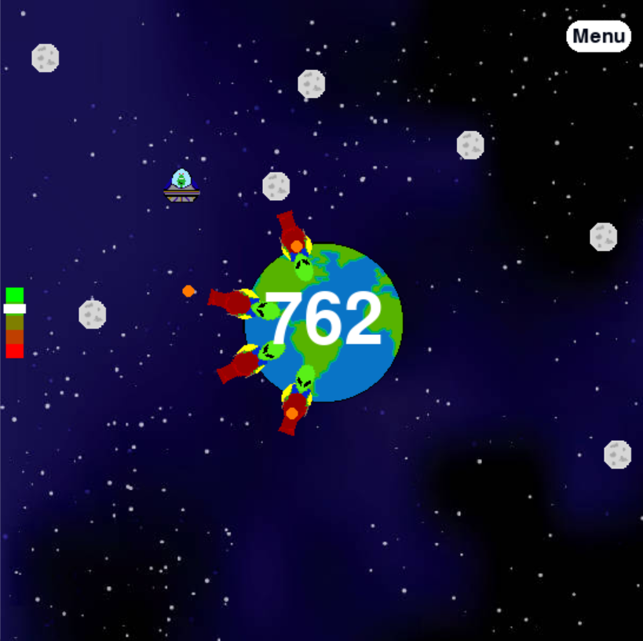

# Abserbrovian Invasion - Video Game
Avoid asteroids and destroy aliens in this fact-paced arcade game built with the Python and Pygame. You pilot a UFO with your mouse, dodge incoming meteors and enemy cannon fire, and try to destroy a planet before it destroys you.

<p align="center">
  
  <em>Gameplay screenshot</em>
</p>


## About This Project

This was an early personal project that I built in early 2024 to strengthen my understanding of classes and object-oriented programming. I used it to practice designing reusable classes (such as `Circle` and `Button`), organizing game logic around them, and seeing how objects interact in a larger program.

**All of the code and all of the artwork in this project were created by me. No AI tools were used to write the code or make the art.**

## Features

- **Mouse-controlled UFO** with a space-bar weapon
- **Meteors** that rain down on the planet, and later in the game, **homing meteors** that chase you
- **Planet defenders**: cannons that spawn on the planet's surface and fire projectiles outward
- **Progressive difficulty**: meteor speed, cannon count, and bullet speed all ramp up the longer you survive
- **Multiple levels**: every 500 points you travel to a new planet (Mars, Earth, or Plunis) with a scrolling transition
- **Health bar**, live score, and a session high score
- **Menu and How To Play screens**

## Getting Started

### Requirements

- Python 3.8+
- [Pygame](https://www.pygame.org/)

### Installation

```bash
git clone https://github.com/J-SmithPosner/planet-game.git
cd planet-game
pip install pygame
```

### Run

```bash
python planet_game.py
```

> Run the game from the project's root folder so it can find the `Assets/` directory.

## How to Play

**Goal:** Destroy the planet. Meteors fall toward it, and every hit adds to your score. Stay alive while the planet's defenders try to stop you.

| Control | Action |
| --- | --- |
| Mouse | Move the UFO |
| Space bar | Shoot |
| Menu button (top right) | Return to the main menu |

### Rules and Scoring

| Event | Result |
| --- | --- |
| A meteor hits the planet | +4 points |
| Your bullet reaches the planet | +1 point |
| You destroy a cannon | +20 points |
| A meteor or enemy bullet hits you | -1 health |
| Ramming a cannon | Destroys it (+20) but costs 1 health |
| Touching the planet | Instant loss |

You start with 5 health. Shooting an enemy bullet destroys that bullet. As your score grows, you can have more of your own bullets on screen at once. After 500 points, some meteors begin homing in on your UFO.

## Project Structure

```
planet-game/
├── planet_game.py     # All game logic
├── Assets/
│   ├── Stary_Space.jpg
│   ├── UFO.png
│   ├── Cannon.png
│   ├── Asteroid.png
│   ├── Mars.png
│   ├── Earth.png
│   └── Plunis.png
├── docs/
│   └── screenshot.png
└── README.md
└── LICENSE
```

## How It Works

A few of the techniques used in the code:

- **Game loop with state modes**: a single loop switches between `menu`, `howto`, `play`, `start`, and `travel` states.
- **Circle-based collision detection**: every object is represented by a circle, and collisions are detected by comparing the distance between centers to the sum of the radii.
- **Vector movement**: meteors, bullets, and cannon projectiles move along normalized direction vectors toward or away from a target, such as the planet or the player.
- **Image rotation around a pivot**: each cannon is rotated to face outward from the planet's center using a custom `blitRotate` function.
- **Time-based difficulty scaling**: spawn limits and speeds are computed from elapsed time and current score.
- **Custom UI**: a reusable `Button` class handles hover and click detection for the menus.

## Credits

- Code: written by me
- Art: all images in the `Assets/` folder were created by me
- Built with [Pygame](https://www.pygame.org/)

## License

This project is licensed under the MIT License. See the `LICENSE` file for details.
